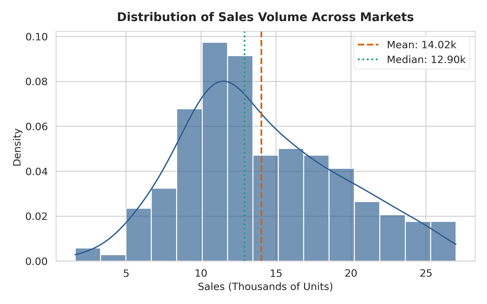
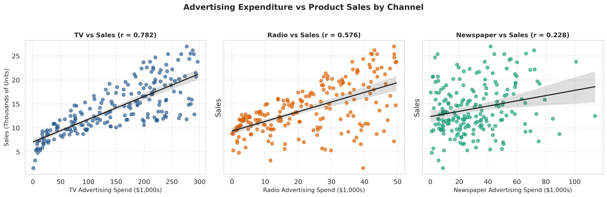
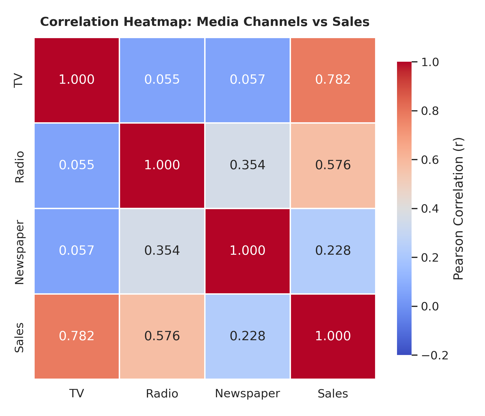
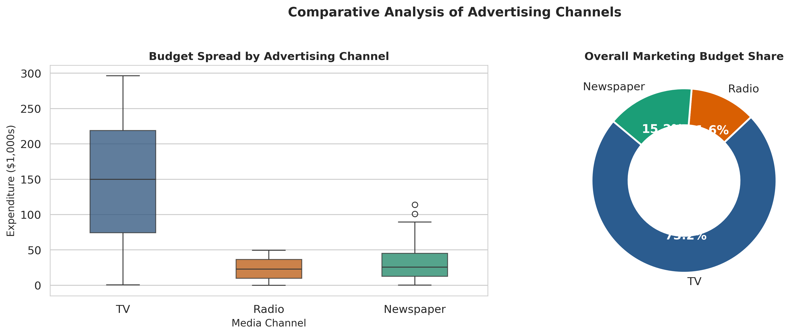
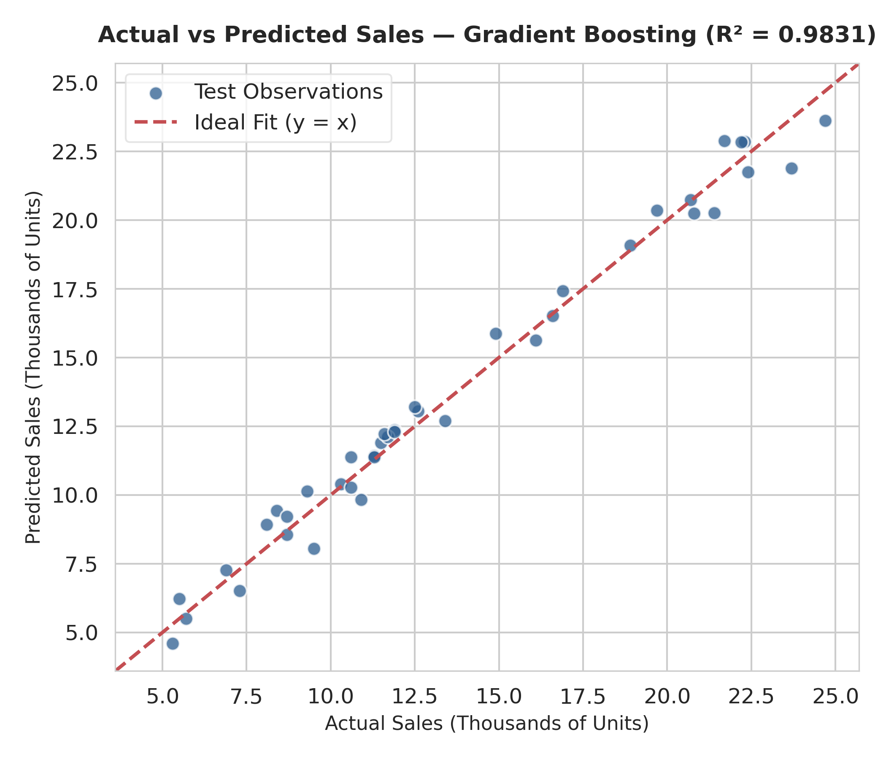
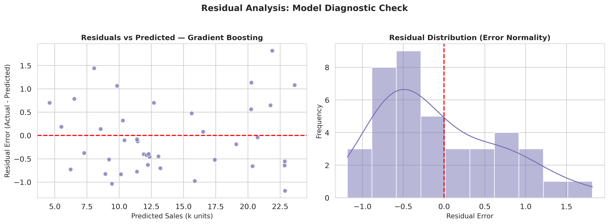
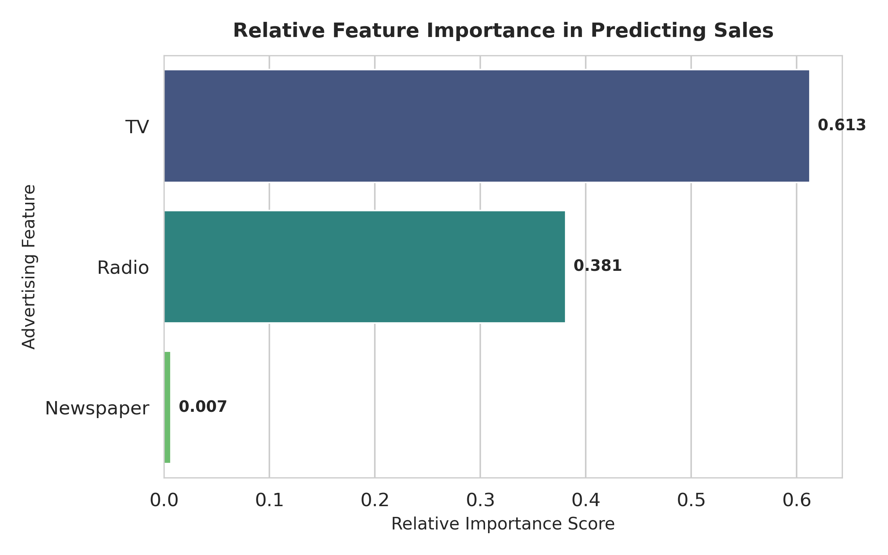

# Sales Prediction using Python 📈

[](https://www.python.org/)
[](LICENSE)
[](https://codealpha.tech/)
[](https://scikit-learn.org/)
[](app.py)

An end-to-end Machine Learning and Data Science project developed for the **CodeAlpha Virtual Internship (Task 4: Sales Prediction using Python)**.

This project analyzes the relationship between marketing advertising expenditures (across Television, Radio, and Newspaper) and product sales. It benchmarks multiple regression algorithms, extracts data-driven marketing intelligence, evaluates error diagnostics, and provides both a CLI pipeline and an interactive **Streamlit** prediction dashboard.

---

## 📌 Table of Contents
1. [Project Overview & Objective](#-project-overview--objective)
2. [Problem Statement](#-problem-statement)
3. [Dataset Attribution & Features](#-dataset-attribution--features)
4. [Technology Stack](#-technology-stack)
5. [Repository Structure](#-repository-structure)
6. [Data Cleaning & Feature Engineering](#-data-cleaning--feature-engineering)
7. [Exploratory Data Analysis (EDA)](#-exploratory-data-analysis-eda)
8. [Machine Learning Models & Evaluation](#-machine-learning-models--evaluation)
9. [Feature Importance & Advertising Insights](#-feature-importance--advertising-insights)
10. [Interactive Streamlit Web Application](#-interactive-streamlit-web-application)
11. [Installation & Windows PowerShell Setup](#-installation--windows-powershell-setup)
12. [How to Run the Project](#-how-to-run-the-project)
13. [Limitations & Future Scope](#-limitations--future-scope)
14. [Author & Acknowledgments](#-author--acknowledgments)

---

## 🎯 Project Overview & Objective

In commercial operations, marketing expenditure is a major capital investment. Forecasting how much sales revenue will be generated from marketing spend across varied channels is essential for optimal budget allocation and Return on Marketing Investment (ROMI).

### Official CodeAlpha Task 4 Deliverables:
- ✅ Collect, clean, and validate sales dataset.
- ✅ Conduct exploratory data analysis with statistical visualizations.
- ✅ Build and benchmark multiple regression models on identical test data.
- ✅ Quantify channel importance and marketing synergy effects.
- ✅ Serialize the fitted pipeline for reproducible inference.
- ✅ Provide comprehensive documentation, Jupyter notebook, and an interactive prediction app.

---

## 💼 Problem Statement

Given historical marketing campaigns across 200 geographic markets:
$$\text{Sales} = f(\text{TV Budget}, \text{Radio Budget}, \text{Newspaper Budget}) + \epsilon$$

We seek to:
1. Identify which advertising media have the strongest relationship with sales volume.
2. Formulate predictive models that forecast sales volume with minimal error.
3. Formulate actionable recommendations regarding budget reallocation.

---

## 📂 Dataset Attribution & Features

- **Dataset Source:** Advertising Sales Dataset (Kaggle / *An Introduction to Statistical Learning* by Gareth James, Daniela Witten, Trevor Hastie, Robert Tibshirani).
- **License:** CC0 Public Domain / Educational Benchmark Dataset.
- **Records:** 200 market campaigns (no missing values, 0 duplicate records).
- **Location in Repo:** [`data/sales_data.csv`](data/sales_data.csv) (and [`data/Advertising.csv`](data/Advertising.csv)).

| Column Name | Type | Description | Units | Historical Range |
| :--- | :---: | :--- | :---: | :---: |
| **TV** | `float64` | Advertising expenditure on Television | $1,000s | $0.7k – $296.4k |
| **Radio** | `float64` | Advertising expenditure on Radio | $1,000s | $0.0k – $49.6k |
| **Newspaper** | `float64` | Advertising expenditure on Newspapers | $1,000s | $0.3k – $114.0k |
| **Sales** *(Target)* | `float64` | Product sales volume | 1,000s of units | 1.6k – 27.0k units |

---

## 🛠 Technology Stack

- **Language:** Python 3.10+
- **Data Manipulation:** `pandas`, `numpy`
- **Visualization:** `matplotlib`, `seaborn`
- **Machine Learning:** `scikit-learn` (`StandardScaler`, `Pipeline`, `LinearRegression`, `DecisionTreeRegressor`, `RandomForestRegressor`, `GradientBoostingRegressor`)
- **Model Serialization:** `joblib`
- **Interactive UI:** `streamlit`
- **Notebook Environment:** Jupyter Notebook (`sales_analysis.ipynb`)

---

## 📁 Repository Structure

```text
CodeAlpha_Sales_Prediction/
│
├── data/
│   ├── sales_data.csv             # Primary sales dataset
│   └── Advertising.csv            # Original source dataset
│
├── notebooks/
│   └── sales_analysis.ipynb       # Step-by-step walkthrough & analysis
│
├── src/
│   ├── __init__.py                # Package initialization
│   ├── data_loader.py             # Ingestion, discovery & validation
│   ├── preprocessing.py          # Data cleaning & train-test split
│   ├── analysis.py                # Statistical analysis & channel metrics
│   ├── visualization.py           # Publication-ready plots generator
│   ├── model_training.py          # Pipelines, benchmarking & metrics
│   └── prediction.py              # Reloading & prediction inference
│
├── models/
│   └── sales_prediction_model.joblib # Serialized best model pipeline
│
├── outputs/
│   ├── plots/                     # High-res generated figures
│   │   ├── 01_sales_distribution.png
│   │   ├── 02_advertising_vs_sales_scatter.png
│   │   ├── 03_correlation_heatmap.png
│   │   ├── 04_ad_spend_by_channel.png
│   │   ├── 05_actual_vs_predicted.png
│   │   ├── 06_residual_plot.png
│   │   └── 07_feature_importance.png
│   ├── cleaned_sales_data.csv     # Cleaned dataset export
│   ├── model_metrics.json         # Real benchmark evaluation scores
│   ├── feature_importance.csv     # Extracted feature weights
│   └── key_findings.txt           # Plain-text business insights summary
│
├── reports/
│   └── sales_analysis_report.md   # Comprehensive analytical report
│
├── app.py                         # Interactive Streamlit dashboard
├── main.py                        # Master pipeline execution script
├── load_dataset.py                # Standalone data loader utility
├── requirements.txt               # Pinned project dependencies
├── README.md                      # Comprehensive project guide
├── .gitignore                     # Git ignore rules
└── LICENSE                        # MIT License
```

---

## 🧹 Data Cleaning & Feature Engineering

1. **Integrity Validation:** Verified 200 non-null records and 0 duplicates.
2. **Bounds Enforcement:** Non-negative constraints applied across spend and sales.
3. **Reproducible Split:** 80% training set (160 campaigns) and 20% hold-out test set (40 campaigns) using `random_state=42`.
4. **Leak-Free Pipelines:** Feature standardization (`StandardScaler`) is fitted strictly on the training set and applied to the test set through `sklearn.pipeline.Pipeline`.

---

## 📊 Exploratory Data Analysis (EDA)

### 1. Market Sales Distribution
Sales volume shows a balanced, near-normal distribution with an average of **14.02k units** and median of **12.90k units**.



### 2. Advertising Expenditure vs. Sales
Scatter plots with linear trendlines illustrate strong positive linear correlation between TV spend and sales, moderate-to-strong correlation for Radio, and high dispersion for Newspaper.



### 3. Correlation Matrix & Budget Allocation
- **TV Correlation ($r = 0.782$):** Primary driver of sales volume.
- **Radio Correlation ($r = 0.576$):** Effective multiplier channel.
- **Newspaper Correlation ($r = 0.228$):** Weak direct correlation.




---

## 🤖 Machine Learning Models & Evaluation

Four regression models were trained on the 80% training set and evaluated on the identical 20% test set (40 hold-out markets).

### Evaluation Metrics Explanation:
- **MAE (Mean Absolute Error):** Average magnitude of absolute error in thousands of units.
- **MSE (Mean Squared Error):** Average squared error, penalizing larger outliers.
- **RMSE (Root Mean Squared Error):** Standard deviation of prediction residuals in original units (thousands).
- **$R^2$ Score (Coefficient of Determination):** Proportion of sales variance explained by features.

### Actual Benchmark Performance:

| Model Name | Train $R^2$ | Test $R^2$ | Test RMSE ($k$ units) | Test MAE ($k$ units) | Test MSE | Status |
| :--- | :---: | :---: | :---: | :---: | :---: | :---: |
| **Gradient Boosting** | **0.9987** | **0.9831** | **0.7295** | **0.6181** | **0.5322** | 🏆 **Best Model** |
| **Random Forest** | 0.9946 | 0.9801 | 0.7935 | 0.6319 | 0.6297 | Runner-Up |
| **Decision Tree** | 0.9838 | 0.9145 | 1.6424 | 1.1944 | 2.6974 | Baseline Tree |
| **Linear Regression** | 0.8957 | 0.8994 | 1.7816 | 1.4608 | 3.1741 | Linear Baseline |

> **Key Finding:** Ensemble methods (Gradient Boosting & Random Forest) significantly outperform linear regression because they capture the non-linear interaction effect between TV and Radio campaigns.

### Model Diagnostic Plots:



---

## 💡 Feature Importance & Advertising Insights

Feature importance extracted from the top-performing Gradient Boosting pipeline:



| Feature | Importance Score | Relative Share (%) | Marketing Takeaway |
| :--- | :---: | :---: | :--- |
| **TV** | `0.6126` | **61.26%** | Anchor channel; essential for broad brand reach and awareness. |
| **Radio** | `0.3809` | **38.09%** | High-efficiency multiplier; provides strong ROI when paired with TV. |
| **Newspaper** | `0.0065` | **0.65%** | Marginal predictive utility; recommended for budget reallocation. |

### Practical Business Guidance:
1. **Budget Reallocation:** Reduce Newspaper expenditure and redirect funds into joint TV + Radio flights.
2. **Media Synergy:** TV builds baseline awareness, while Radio reinforces call-to-action frequency at lower unit cost.
3. **Forecasting Reliability:** An $R^2$ score of **0.9831** confirms that advertising spending explains over 98% of sales variance in this market setting.

---

## 💻 Interactive Streamlit Web Application

An interactive web dashboard is provided in [`app.py`](app.py) allowing users to simulate marketing budgets and obtain instant sales forecasts.

```bash
python -m streamlit run app.py
```

### Features of the Web App:
- Dynamic sliders for TV, Radio, and Newspaper expenditures ($1,000s).
- Live budget share calculations.
- Instant sales volume forecast (thousands of units) and estimated gross revenue.
- Performance comparison against historical market averages.
- Built-in EDA visualization tabs.

---

## ⚙️ Installation & Windows PowerShell Setup

### 1. Clone the Repository
```powershell
git clone https://github.com/VaishnavSreejan/CodeAlpha_Sales_Prediction.git
cd CodeAlpha_Sales_Prediction
```

### 2. Create and Activate Virtual Environment
```powershell
python -m venv venv
.\venv\Scripts\Activate.ps1
```

*Note: If PowerShell displays an `Execution_Policies` restriction error, activate with:*
```powershell
Set-ExecutionPolicy -ExecutionPolicy RemoteSigned -Scope Process
.\venv\Scripts\Activate.ps1
```
*Or execute directly with:*
```powershell
.\venv\Scripts\python.exe main.py
```

### 3. Install Dependencies
```powershell
pip install -r requirements.txt
```

---

## 🚀 How to Run the Project

### Execute the Full Machine Learning Pipeline
Runs data loading, cleaning, EDA, model training, evaluation, plot generation, and inference test:
```powershell
python main.py
```

### Run the Interactive Streamlit App
```powershell
python -m streamlit run app.py
```

### Run the Jupyter Notebook
```powershell
jupyter notebook notebooks/sales_analysis.ipynb
```

### Run Standalone Data Loader
```powershell
python load_dataset.py
```

---

## ⚠️ Limitations & Future Scope

### Limitations:
- **Sample Size:** 200 market campaigns represent a relatively compact dataset.
- **Cross-Sectional Nature:** Observations lack explicit calendar timestamps or seasonality indicators.
- **Missing Attribution Channels:** Modern digital advertising channels (Social Media, PPC, Influencers) are not represented in this historical benchmark.

### Future Improvements:
- Collect longitudinal time-series sales data to capture seasonal spikes (holidays, weekends).
- Incorporate digital conversion metrics (Click-Through Rate, Impressions, Cost-per-Acquisition).
- Test Bayesian Marketing Mix Modeling (MMM) for multi-channel budget optimization.

---

## 👨‍💻 Author & Acknowledgments

- **Author:** Vaishnav Sreejan  
- **Internship:** [CodeAlpha](https://codealpha.tech/) Data Science Virtual Internship  
- **LinkedIn:** [Vaishnav Sreejan](https://www.linkedin.com/in/vaishnav-sreejan/)  
- **Repository:** [CodeAlpha_Sales_Prediction](https://github.com/VaishnavSreejan/CodeAlpha_Sales_Prediction)  

*Special thanks to CodeAlpha for providing this practical project assignment.*

---

## 🏷️ Topics
`machine-learning` `data-science` `sales-prediction` `regression` `scikit-learn` `python` `streamlit` `gradient-boosting` `eda` `codealpha`
